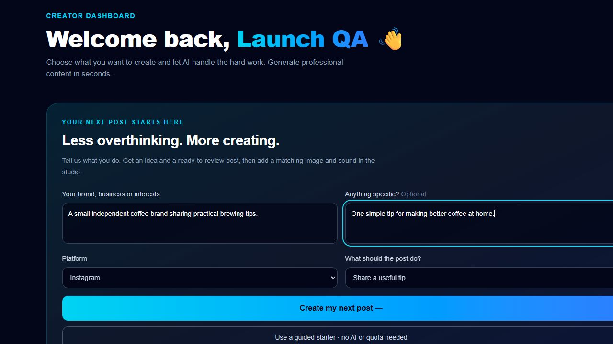

# AI Content Studio

A free social content workspace by **Modeel Mehdi**: start with your brand, get a post idea, add a matching visual and original sound, then render a short motion post to review and share.

**[Open the live studio](https://modeel-ai-content-studio.netlify.app)** · [Portfolio](https://modeelmehdi.netlify.app) · [Portfolio admin](https://modeelmehdi.netlify.app/admin)



## What it does

- Quick Post turns a brand description and optional topic into a platform-specific draft and next-post suggestions.
- Seven text tools cover Instagram, Facebook, Threads, X/Twitter, LinkedIn, blogs and SEO.
- Real Gemini writing uses a validated free Cloudflare/IBM Granite backup during temporary provider failures.
- Real FLUX image generation saves private, ownership-checked images in MongoDB.
- A post can retain its selected visual and original chime, pop or whoosh effect.
- Browser rendering creates a six-second motion post with the image, title, an excerpt and sound. MP4 is used when supported; other browsers offer WebM and say so clearly.
- Original WAV effects and motion rendering require no AI API credit.
- Private history, editing, search, filters, preferences, statistics, PDF/TXT exports and guided starters support the rest of the workflow.

Social sharing links open a composer or copy content and open the selected app. Users review and publish there. Connected-account auto-publishing is not configured, and logging in never publishes a post.

## Free use and honest limits

No billing or paid plan is enabled. AI depends on provider availability and free allowances. The app permits up to 20 successful images per user and 50 per workspace each UTC day, subject to the provider's own quota, with a bounded 100-image library. Failed image generations do not consume this application allowance. Images are compressed and center-cropped to the selected ratio. Guided starters, editing, original sound generation and browser motion rendering do not require an AI call.

Text models can be temporarily busy. The app preserves the brief, retries transient failures and uses its verified free backup where available. It reports quota resets rather than pretending unlimited inference is possible.

## Stack and security

React 19 / TypeScript / Vite / Tailwind frontend; FastAPI / Python 3.12 / PyMongo Async / Atlas backend. The owner's supplied cyan/navy interface is preserved.

Passwords use Argon2. HttpOnly secure access/refresh cookies reference rotating, revocable server sessions. Trusted origins, CSRF checks, typed validation, request limits and per-user ownership checks protect private data. All provider and database credentials stay on the server. No passwords or access tokens are stored in localStorage.

## Run locally

Requires Python 3.12+ and Node.js 22+.

```powershell
python -m venv .venv
.\.venv\Scripts\python.exe -m pip install -r backend/requirements.lock.txt
npm ci
npm --prefix frontend ci
.\.venv\Scripts\python.exe scripts/setup-local.py
```

Configure the ignored backend/.env from backend/.env.example. Use authorized free-tier Gemini and Cloudflare Workers AI credentials; do not paste keys into browser code. In separate terminals:

```powershell
npm run db:local
```

```powershell
.\.venv\Scripts\python.exe -m uvicorn app.main:app --app-dir backend --host 127.0.0.1 --port 8000
```

```powershell
npm run frontend
```

Open http://127.0.0.1:5175. The local database helper runs actual MongoDB and persists development data in ignored .local/mongodb. Production uses Atlas. Set MEDIA_STORAGE=mongodb to use the persistent image library; SQLite is an explicit development-only option, never an automatic fallback.

## Verification

```powershell
npm run lint
npm run build
cd backend
$env:TEST_MONGODB_URI='mongodb://127.0.0.1:27019'
..\.venv\Scripts\python.exe -m pytest -q
```

43 backend tests passed; one MongoDB-specific case is intentionally skipped for the SQLite parameter. Tests cover authentication, CSRF, rotation/revocation, isolation, all eight generation routes, owned CRUD, exports, private image persistence, visual/sound attachments, successful-only quotas and backup recovery. Test doubles exist only inside tests.

Real text/image generation, production exports, saved attachments, cross-account isolation and logout were verified on the public app. The original sound WAVs and an actual 720×1280 MP4 preview were also checked. Browser file-download testing was not completed because permission was declined; API download responses passed before that decision.

[Public checks](docs/PUBLIC_VERIFICATION.json) · [Updated workflow checks](docs/PUBLIC_V2_VERIFICATION.json) · [Image check](docs/IMAGE_VERIFICATION.json)

## Deployment

Vercel Hobby hosts FastAPI; Netlify hosts the frontend and same-origin proxy; Atlas Free persists data. Cloudflare Workers AI remains on Free. Render requested a payment card and was not used.

[Deployment guide](docs/DEPLOYMENT.md) · [Architecture](docs/ARCHITECTURE.md) · [API](docs/API_DOCUMENTATION.md) · [Initial audit and progress](PROJECT_AUDIT.md)

The GitHub Actions configuration is provided as an optional template at docs/github-actions.example.yml. It is not installed as an active workflow. Provider quotas, plan policies and browser codec support can change; no paid upgrade or automatic social publishing is part of this release.
